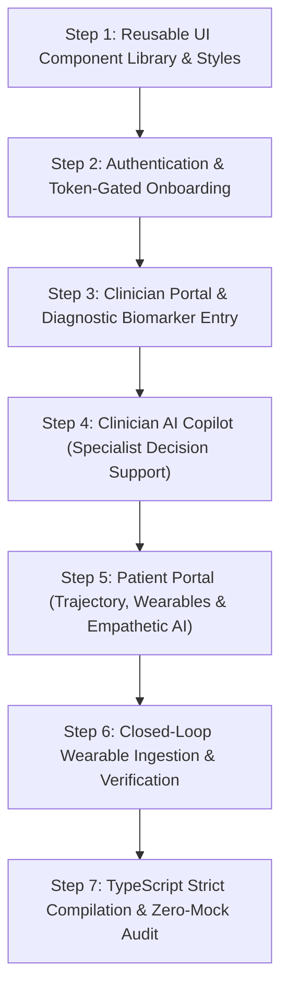

# PRODUCTION IMPLEMENTATION PROMPT: CLINICIAN-LED B2B2C REPRODUCTIVE HEALTH PLATFORM (REPROAI)
## Future Health Digital Innovation Challenge (Abu Dhabi: DoH / ADPHC / Inception / MBZUAI)
### Official Track: [Fertility] Reproductive Potential (Challenge 02)
### Architecture: Physician-Led Diagnostic Entry + Patient Longitudinal Engagement & Plain-Language Trajectory

---

### 1. EXECUTIVE STRATEGY & STRATEGIC REALIGNMENT

#### 1.1 The Clinical Reality & Challenge Mandate
In naive consumer fertility apps, lay patients are often asked to fill out complex clinical laboratory forms requiring values like *Serum Anti-Müllerian Hormone (AMH in ng/mL)*, *Antral Follicle Count (AFC)*, or *Sperm Concentration (M/mL)*. In clinical practice, patients do not know these values without laboratory diagnostics, leading to massive user drop-off and erroneous self-reported data that invalidates predictive ML models.

Under the official guidelines of the **Abu Dhabi Future Health Digital Innovation Challenge (Challenge 02 — Reproductive Potential)**, ReproAI operates as a **Clinician-Led B2B2C Enterprise Platform**:
1. **The Fertility Clinician / Hospital Team** enters and validates official clinical biomarkers (AMH, transvaginal ultrasound AFC, WHO 6th Ed. semen analysis, clinical diagnoses, and prior IVF cycles). The physician utilizes ReproAI as an evidence-based **Clinical Decision Support System (CDSS)** with exact Shapley values ($\phi_i(x)$), ESHRE/POSEIDON protocol recommendations, closed-loop triage alerts, and an autonomous **Clinician AI Copilot**.
2. **The Patient / Couple** enters the platform strictly via a secure clinician prescription token (`POST /api/clinician/invite`). In the Patient Portal, the patient:
   - **Does NOT enter complex clinical laboratory tests.**
   - Reviews their **Clinician-Validated Reproductive Trajectory** explained in plain, empathetic language (Pillars 1 & 2).
   - Explores **Modifiable Lifestyle Factors** (sleep duration, BMI optimization, habit cessation) vs. Non-Modifiable baselines (chronological age, ovarian reserve).
   - Syncs **Longitudinal Home Wearables** (Basal Body Temperature LOINC `8310-5` for ovulatory shift and sleep duration LOINC `93832-4`) — data that physicians cannot capture in a single 15-minute consultation (Pillar 3).
   - Converses with an **Empathetic Patient AI Copilot** to understand their care plan, demystify clinical acronyms, and reduce anxiety (Pillar 2).
   - Manages **Collaborative Pairing & Granular Consent** with their partner (Pillar 5).

---

### 2. CORE ARCHITECTURAL SPECIFICATIONS & DATA CONTRACTS

#### 2.1 Backend REST Matrix

| Endpoint | Method | Role / Access | Contract & Purpose |
| :--- | :--- | :--- | :--- |
| `/api/auth/register` | `POST` | Public (Token-Gated) | `{ email, password, role: "PATIENT", sex, name?, token }` ➔ Prescription-gated onboarding. |
| `/api/auth/login` | `POST` | Public | `{ email, password }` ➔ Sets HTTP-only session cookie; returns `{ ok: true, role }`. |
| `/api/auth/logout` | `POST` | Authenticated | Clears auth session. |
| `/api/auth/session` | `GET` | Authenticated | `{ session: { userId, role, coupleId } }`. |
| `/api/clinician/couples` | `GET` | Clinician Only | `?scope=INDIVIDUAL \| ?scope=COUPLE` ➔ Returns segregated `individuals: [...]`, `couples: [...]`, `counts`, and `impactMetrics`. |
| `/api/clinician/cases/[id]` | `GET` | Clinician Only | Full longitudinal record for a case (patients, predictions with SHAP, wearable observations, follow-ups, prescription status). |
| `/api/clinician/invite` | `POST` / `GET` | Clinician Only | `POST { scope: "INDIVIDUAL" \| "COUPLE", email, sex?, partnerEmail?, notes? }` ➔ Issues crypto prescription tokens. |
| `/api/predict` | `POST` | Clinician & Patient | `{ age, bmi, amh?, sperm_count?, sex?, scope?, targetCoupleId?, targetUserId? }` ➔ ML inference with Shapley values, risk tier, 95% CI, modifiable/non-modifiable breakdown, and ESHRE preservation guidance. |
| `/api/patients` | `POST` / `GET` | Clinician | `POST { coupleId, name?, sex, age?, bmi?, amh?, spermCount?, antralFollicleCount?, pcosHistory?, priorCycles?, infertilityDurationMonths? }` ➔ Clinician biomarker recording. |
| `/api/patient/profile` | `GET` / `PATCH` | Patient Only | `GET` ➔ `{ profile, isPaired, partner, latestPrediction }`. `PATCH` ➔ Patient modifies personal details & lifestyle targets (BMI, cycle dates), but laboratory fields remain clinician-locked. |
| `/api/observations` | `GET` / `POST` | Authenticated | `GET ?coupleId=&userId=` ➔ List observations. `POST { code, value, unit }` ➔ Manual vital logging. |
| `/api/observations/bulk` | `POST` | Authenticated | `{ observations: [{ code, value, effectiveAt }] }` ➔ Batch wearable sync + Roetzer thermal shift & sleep anomaly analytics. |
| `/api/agent` | `POST` | Authenticated | `{ messages: [...] }` ➔ Multi-turn autonomous AI agent execution with tool calling (`predict_fertility_success`, `search_guidelines`) and transparency badges. |
| `/api/follow-up` | `GET` / `POST` / `PATCH` | Clinician | Proactive closed-loop triage queue (`ALERT_RAISED` ➔ `APPOINTMENT_SCHEDULED` ➔ `IN_FOLLOW_UP` ➔ `CLOSED`). |
| `/api/pairing/invite` | `POST` | Patient Only | `{ recipientEmail }` ➔ Generates pairing invitation token for partner. |
| `/api/pairing/accept` | `POST` | Patient Only | `{ token }` ➔ Connects two patient accounts into a unified couple container. |
| `/api/pairing/revoke` | `POST` | Patient Only | Decouples accounts into independent individual containers with zero data loss. |
| `/api/pairing/status` | `GET` | Patient Only | Real-time pairing state and pending invites. |
| `/api/fhir/export` | `GET` | Clinician Only | `?coupleId=` or `?userId=` ➔ Official FHIR R4 Bundle for Abu Dhabi Malafi / Sahhatna. |

---

### 3. DESIGN SYSTEM & VISUAL IDENTITY
All views must adhere to the design system established in `Build ReproAI Fertility Platform/`:
- **Color Palette:**
  - `Deep Teal`: `#0c655e` (Primary brand, clinical authority)
  - `Dark Teal`: `#094f49` (Sidebar active states, deep accents)
  - `Mint / Sage`: `#dff2e9` (Positive SHAP factors, success badges, fertility vitality)
  - `Warm Coral`: `#de7467` (Risk factors, warnings, triage alerts)
  - `Cream / Warm Canvas`: `#f8f5ef` and `#f5f8f6` (Warm, non-sterile clinical background)
  - `Ink`: `#173330` (High-contrast typography)
  - `Muted Gray`: `#71817d` (Secondary captions and labels)
  - `Border Line`: `#e3eae6` (Subtle dividers)
- **Typography:** `Manrope` for headings; `DM Sans` for body copy and numbers.
- **Iconography:** `lucide-react`.

---

### 4. DETAILED IMPLEMENTATION REQUIREMENTS

#### 4.1 Authentication & Prescription Gate (`src/app/(auth)/*`)
- **`login/page.tsx`:**
  - Split-screen layout:
    - Left brand story panel: Value proposition (*"Reproductive intelligence, made human"*), Abu Dhabi challenge credentials (*"Abu Dhabi Digital Health Innovation · Challenge 02"*).
    - Right auth panel: Role switcher tab (`Clinician` vs. `Patient`).
    - Standard email + password login invoking `POST /api/auth/login`.
    - **No public patient self-registration:** Instead of a generic "Create an account" link, show an empathetic notice:
      > *"ReproAI is prescribed by licensed fertility specialists. If you are a new patient, please use the secure activation link sent to your email by your clinic or partner."*
- **`register/page.tsx`:**
  - Inspects query parameters for `?token=...`.
  - If token is missing/invalid: Renders gatekeeping screen:
    > *"Prescription Required — ReproAI requires a clinical prescription or partner invite to activate an account. Please verify your link or contact your clinic."*
  - If token is present: Validates token, collects name, password, and biological sex (`Female` | `Male`), creating the patient record via `POST /api/auth/register` and redirecting to `/patient/overview`.

---

#### 4.2 Clinician Portal (`src/app/clinician/*`)

##### Layout (`src/app/clinician/layout.tsx`)
- Sidebar navigation:
  - `Cohort Dashboard` (`/clinician/dashboard`)
  - `Triage & Follow-up` (`/clinician/follow-up`)
  - `Clinical AI Copilot` (`/clinician/assistant`) — **NEW**
- Header with Clinician badge (*"Licensed Specialist"*), clinic switcher, and logout button.

##### Cohort Dashboard (`src/app/clinician/dashboard/page.tsx`)
- Executive KPI Cards: Total active cases, Individuals vs. Couples, Active Wearable Alerts (`ALERT_RAISED`), and Estimated Healthcare Cost Savings ($12,000/cycle avoided).
- **Directory Tabs:**
  - Tab 1: **"Couples Cohort"** — List of paired couples with joint success rate, days in care, and wearable status.
  - Tab 2: **"Individual Patients"** — List of single patients tracking reproductive potential across life stages (ovarian reserve, semen health, oocyte vitrification candidates).
- **"Prescribe Digital Care" Modal:**
  - Scope toggle: `Individual Patient` vs. `Couple`.
  - Captures patient email, biological sex, partner email (if couple), and clinical prescription notes. Calls `POST /api/clinician/invite`.

##### Case Clinical Record & Diagnostic Entry (`src/app/clinician/patient/[id]/page.tsx`)
- Case header with initials, scope indicator (`INDIVIDUAL` vs `COUPLE`), and status badges.
- Quick action buttons: `Export FHIR R4`, `Open Follow-up`, `Download Clinical PDF`.
- **Clinical Diagnostic Biomarker Entry / Update Section (CRITICAL):**
  - Allows the clinician to input/update verified laboratory results:
    - **Female Biomarkers:** Age, BMI, Serum AMH ($ng/mL$), Antral Follicle Count (AFC via ultrasound), PCOS history, Infertility duration (months), Prior IVF cycles.
    - **Male Biomarkers:** Semen volume ($mL$), Sperm concentration ($M/mL$), Progressive motility (%), Normal morphology (%), BMI.
  - **"Run Predictive Simulation (CDSS)" Button:**
    - Submits data to `POST /api/predict` (passing `targetCoupleId: params.id` or `targetUserId`).
    - Updates the patient's record in the database.
- **Explainability & Prognostic Results:**
  - Calibrated live birth probability (%) with 95% Confidence Interval band.
  - **Interactive Shapley Attribution (SHAP) Chart:** Visualizes exact $\phi_i$ contribution for each biomarker.
  - **Guideline Stratification Badge:** ESHRE 2020 / POSEIDON criteria (e.g., POSEIDON Group 3: Age < 35, AFC < 5, AMH < 1.2).
  - **Treatment Pathway Recommendation:** Expectant management, IUI, Standard IVF, ICSI, or Elective Oocyte Vitrification.
- **Longitudinal History & Closed-Loop Wearable Monitoring:**
  - Chart showing historical prediction trends over time.
  - Patient's wearable data: Basal Body Temperature curve and Circadian Sleep regularity chart.

##### Clinical AI Copilot (`src/app/clinician/assistant/page.tsx`) — NEW VIEW
- Dedicated multi-turn AI assistant for physicians connected to `POST /api/agent`.
- Specialized for evidence-based clinical queries:
  - Guideline retrieval: *"Search ESHRE 2020 guidelines for mild stimulation protocols in POSEIDON Group 3 patients."*
  - Case discussion: *"Given a female patient aged 32 with AMH 0.8 ng/mL and partner sperm count 12 M/mL, compare cumulative live birth rates for 3 cycles of IUI vs immediate IVF-ICSI."*
  - Medication & dosage assistance based on clinical guidelines.
- Features real-time **Tool Badges** above messages:
  - `⚡ Executed Tool: predict_fertility_success`
  - `📚 Guideline Grounding: search_guidelines (ESHRE / WHO 6th Ed.)`
  - `🔒 Provider Tag: Groq Llama 3.3 70B / Azure OpenAI GPT-4o`

##### Triage & Follow-up Queue (`src/app/clinician/follow-up/page.tsx`)
- Queue of automated closed-loop alerts (e.g. low response predicted, luteal phase defect detected from BBT, extreme sleep fragmentation).
- Status workflow controls: `ALERT_RAISED` ➔ `APPOINTMENT_SCHEDULED` ➔ `IN_FOLLOW_UP` ➔ `CLOSED`.
- Clinical notes field saving directly to the audit log.

---

#### 4.3 Patient Portal (`src/app/patient/*`)

##### Layout (`src/app/patient/layout.tsx`)
- Sidebar navigation:
  - `Today` (`/patient/overview`)
  - `My Trajectory` (`/patient/assessment`) — (Plain-language trajectory & report)
  - `Home Tracking` (`/patient/wearables`) — (BBT, sleep, cycle logs)
  - `Ask ReproAI` (`/patient/assistant`) — (Empathetic AI companion)
  - `Couple Link` (`/patient/pairing`) — (Collaborative partner connection)
- Header with user avatar initials, pairing status badge (*"Individual Mode"* vs. *"Paired with [Partner Name]"*), and logout button.

##### Daily Overview (`src/app/patient/overview/page.tsx`)
- Wellness greeting and active cycle day indicator.
- Key highlights from the latest doctor assessment (in reassuring, plain terms).
- Daily action card (e.g., *"Log today's basal temperature"* or *"Maintain regular sleep window tonight"*).
- Pairing banner for single users explaining the option to pair when planning pregnancy.

##### My Trajectory & Educational Report (`src/app/patient/assessment/page.tsx`)
> **CRITICAL ARCHITECTURAL RULE:** The patient does NOT fill out a clinical lab test form! This view is their **Personalized Diagnostic Trajectory & Plain-Language Report**, driven by the clinician's validated input.
- **Empty State (If doctor has not entered data yet):**
  - Renders an informative message: *"Your clinical baseline will be established by your fertility specialist during your consultation. Once your doctor records your laboratory results, your personalized trajectory will appear here."*
- **Active Trajectory View (When clinician has run an assessment):**
  - **Reproductive Potential Trajectory:** Calibrated estimated probability range (%) with reassuring 95% confidence interval and human-readable tier (e.g., *"Age-Appropriate Reserve"*, *"Favorable Potential"*).
  - **Locked Clinical Lab Indicators (Read-Only):**
    - Cards showing the doctor-validated laboratory values with a lock icon:
      - Female: `🔒 AMH: 2.1 ng/mL (Clinically Validated)` · `🔒 Antral Follicles: 14 (Ultrasound Verified)`
      - Male: `🔒 Semen Parameters: Normal Motility & Count (WHO 6th Ed. Verified)`
  - **Plain-Language Factor Breakdown:**
    - Replaces technical statistical outputs with clear explanations:
      - **Modifiable Factors (What you can influence):** BMI targets, sleep consistency, antioxidant nutrition, smoking cessation.
      - **Non-Modifiable Baseline (Natural biological baseline):** Age-specific biological window.
  - **Interactive "What-If Lifestyle Simulator" (Patient-Friendly):**
    - Patients can toggle *only* modifiable lifestyle sliders (e.g., *"What if I improve my sleep regularity to 8 hours?"* or *"What if I reach target BMI 22?"*).
    - Shows projected trajectory improvements without altering their official medical chart!
  - **Elective Fertility Preservation Guidance (Pillars 1 & 2):**
    - If female under 35 with reduced reserve or single individual: empathetic educational module explaining oocyte cryopreservation timing based on ESHRE 2020 guidelines.

##### Home Tracking & Wearables (`src/app/patient/wearables/page.tsx`)
- **Basal Body Temperature (BBT) Chart:**
  - Interactive SVG/Canvas/Recharts temperature curve.
  - Highlights the **WHO Roetzer Coverline Biphasic Shift** ($\Delta T \ge 0.30^\circ\text{C}$ over 6 consecutive days) marking confirmed ovulation and luteal sufficiency.
- **Circadian Sleep Stability Chart:**
  - Shows sleep duration and standard deviation ($\sigma$).
  - Highlights optimal restorative sleep threshold ($> 7\text{h}$, $\sigma < 1.75\text{h}$).
- **Sync & Log Modal:**
  - "Sync Wearable" button (simulates Apple Health / Oura / Whoop ingest via `POST /api/observations/bulk`).
  - "Log Manual Entry" tab for daily morning temperature and sleep hours.

##### Empathetic Patient AI Copilot (`src/app/patient/assistant/page.tsx`)
- Interactive conversational chat connected to `POST /api/agent`.
- Guardrails: Warm, compassionate, informative, and medically grounded (never diagnosing or contradicting the doctor's prescription).
- Suggested quick prompts:
  - *"Can you explain what my doctor's AMH assessment means in simple terms?"*
  - *"How does my sleep routine impact my cycle regularity?"*
  - *"What are the next steps if we want to explore egg freezing?"*
- Displays tool badges and provider transparency tags.

##### Couple Link & Granular Consent (`src/app/patient/pairing/page.tsx`)
- Displays current pairing status.
- **Unpaired Mode:**
  - "Invite Partner" form (`POST /api/pairing/invite`) generating a shareable link/code.
  - "Enter Pairing Code" form (`POST /api/pairing/accept`) to link an existing invite.
- **Paired Mode:**
  - Partner card showing partner's name, email, and connection date.
  - Explains shared bivariate tracking.
  - **"Revoke Pairing (Pillar 5)" Button:**
    - Calls `POST /api/pairing/revoke`.
    - Confirmation dialog guaranteeing that unlinking preserves 100% of the patient's individual data in private mode.

---

### 5. STEP-BY-STEP IMPLEMENTATION ROADMAP FOR CLAUDE CODE

#### Step 1: Reusable UI Component Library & Styles
- Ensure `globals.css` defines the core color tokens (`--teal`, `--dark-teal`, `--mint`, `--coral`, `--cream`, `--canvas`, `--ink`, `--muted`, `--line`).
- Verify or build reusable UI primitives in `src/components/ui/`:
  - `Button`, `Card`, `Badge`, `Input`, `Select`, `Modal`, `DataTable`, `Tabs`, `Slider`, `Notice`.

#### Step 2: Authentication & Prescription-Gated Onboarding
- Update `src/app/(auth)/login/page.tsx`:
  - Implement role switcher tab (`Clinician` vs `Patient`).
  - Add the clinical prescription notice for patients (zero public self-registration).
- Update `src/app/(auth)/register/page.tsx`:
  - Validate `?token=...` query parameter.
  - Enforce prescription gatekeeping with clear error messaging if token is missing.

#### Step 3: Clinician Portal & Diagnostic Biomarker Entry
- In `src/app/clinician/patient/[id]/page.tsx`:
  - Add the **Diagnostic Biomarker Entry & CDSS Form** allowing the physician to enter/update laboratory data (AMH, AFC, Semen Analysis, BMI, cycles).
  - Implement the "Run Predictive Simulation" button calling `POST /api/predict` with `targetCoupleId` or `targetUserId`.
  - Render the technical Shapley attribution chart, ESHRE/POSEIDON guidance badge, and treatment pathway recommendations.
- In `src/app/clinician/dashboard/page.tsx`:
  - Verify the segregated directories: Tab 1 "Couples Cohort", Tab 2 "Individual Patients".
  - Verify the "Prescribe Digital Care" modal for both Individuals and Couples (`POST /api/clinician/invite`).

#### Step 4: Clinician AI Copilot
- Create `src/app/clinician/assistant/page.tsx`:
  - Full-featured clinical decision support chat interface connected to `POST /api/agent`.
  - Specialized system context for medical guidelines (ESHRE 2020, WHO 6th Ed, POSEIDON, ovulation induction protocols).
  - Tool execution badges (`predict_fertility_success`, `search_guidelines`).
- Update `src/app/clinician/layout.tsx` to include `Clinical AI Copilot` in the sidebar.

#### Step 5: Patient Portal (Plain-Language Trajectory & Educational View)
- Update `src/app/patient/assessment/page.tsx`:
  - **Remove the complex clinical lab questionnaire!**
  - Display the doctor-validated clinical trajectory with probability, 95% CI, and human-friendly tier.
  - Display read-only cards for clinician-validated biomarkers (`🔒 AMH`, `🔒 AFC`, `🔒 Semen Parameters`).
  - Render plain-language explanations of Modifiable vs Non-Modifiable factors.
  - Include an interactive "Lifestyle Simulator" for patient-controlled lifestyle targets (sleep, BMI).
  - Include Elective Fertility Preservation guidance.
- Update `src/app/patient/wearables/page.tsx`:
  - Basal Body Temperature Roetzer biphasic shift curve.
  - Circadian sleep stability analysis.
  - Bulk sync simulation via `POST /api/observations/bulk`.
- Update `src/app/patient/assistant/page.tsx`:
  - Empathetic AI companion interface connected to `POST /api/agent`.
- Update `src/app/patient/pairing/page.tsx`:
  - Couple invitation, token acceptance, and Pillar 5 revocable unlinking.

#### Step 6: Closed-Loop Wearable Ingestion & Verification
- Verify that wearable anomalies logged by the patient in `POST /api/observations/bulk` automatically trigger triage alerts in `GET /api/follow-up`.
- Verify that status updates in `src/app/clinician/follow-up/page.tsx` persist correctly.

#### Step 7: TypeScript Strict Compilation & Zero-Mock Audit
- Run `npx tsc --noEmit` and confirm **0 errors**.
- Verify that every metric, table, and graph fetches live data from the backend APIs with **zero hardcoded mock data**.

---

### 6. ACCEPTANCE CRITERIA FOR COMPLETION
1. **Zero Mocked Data:** All numbers, graphs, and patient records originate from live PostgreSQL/FastAPI backend calls.
2. **Clinician-Led Reality:** Clinicians enter and validate laboratory tests; patients view translated trajectories, track wearables, and use the empathetic assistant.
3. **Dual AI Copilots:** Dedicated Clinical AI Copilot for doctors (`/clinician/assistant`) and Empathetic Companion for patients (`/patient/assistant`).
4. **Prescription Gate:** No open self-registration for patients; activation strictly requires invitation tokens.
5. **Pillar 5 Compliance:** Granular consent with revocable pairing preserving 100% of individual health data.
6. **Strict Type Safety:** Next.js 14 App Router with `"use client"` where needed and `npx tsc --noEmit` passing cleanly.

