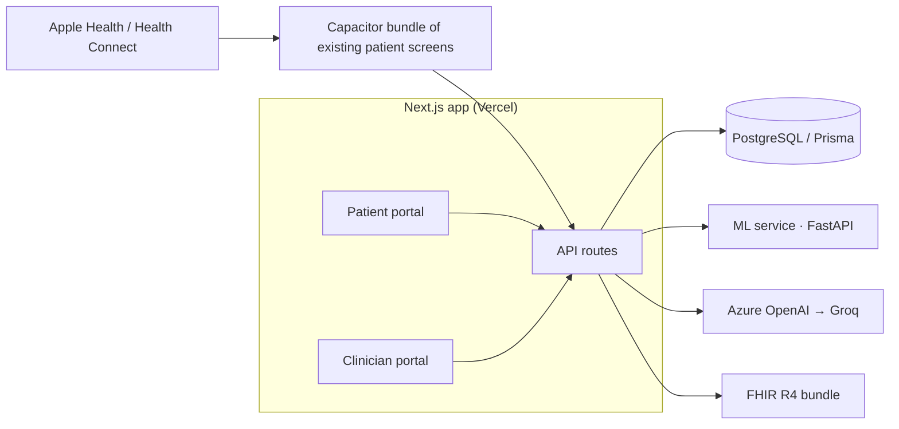
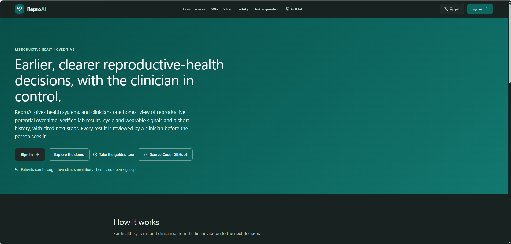
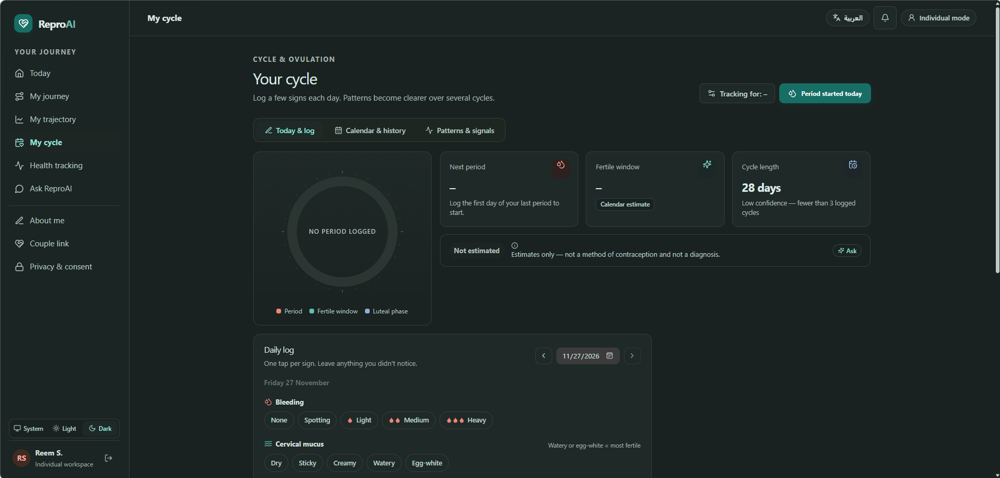
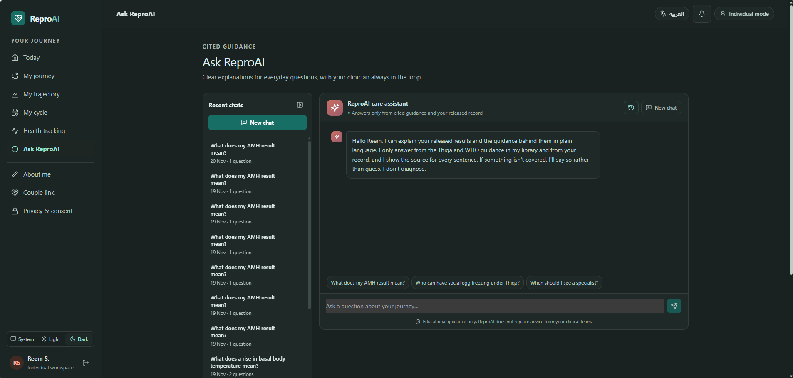
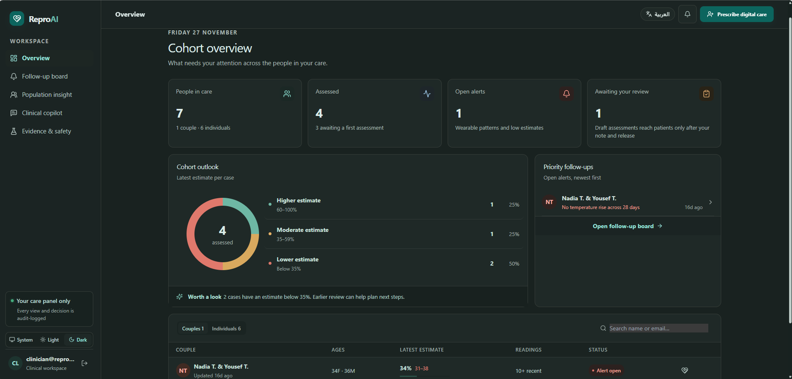
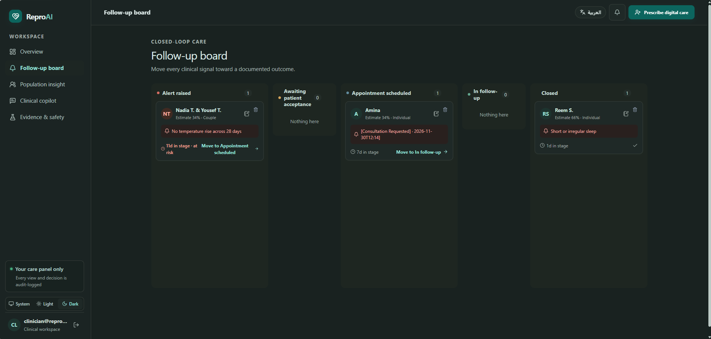
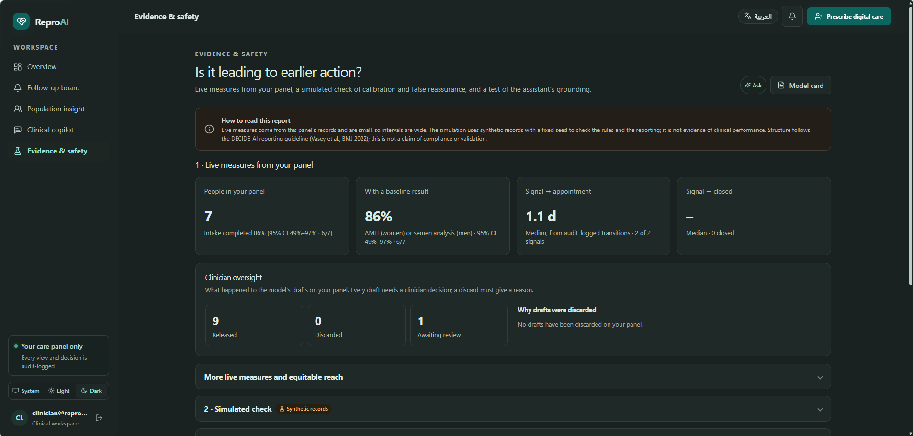

<h1 align="center">
  <a href="https://github.com/renatocosta0/reproai-main">
    
  </a>
  <br>
  ReproAI
</h1>

<div align="center">
  An evidence-led view of reproductive potential over time, for individuals and couples, prescribed by their clinic.
  <br />
  <br />
  <a href="https://github.com/renatocosta0/reproai-main/issues/new?labels=bug&title=bug%3A+">Report a Bug</a>
  ·
  <a href="https://github.com/renatocosta0/reproai-main/issues/new?labels=enhancement&title=feat%3A+">Request a Feature</a>
  ·
  <a href="docs/evaluation-mapping.md">Judging Criteria Mapping</a>
</div>

<div align="center">
<br />

[](https://nextjs.org)
[](https://www.typescriptlang.org)
[](ml-service)
[](prisma/schema.prisma)
[](docs/fhir-interoperability.md)
[](docs/evaluation-mapping.md)

</div>

<details open="open">
<summary>Table of Contents</summary>

- [About](#about)
  - [Key features](#key-features)
  - [Built With](#built-with)
  - [Architecture](#architecture)
- [Screenshots (Web & Mobile)](#screenshots-web--mobile)
- [Getting Started](#getting-started)
  - [Prerequisites](#prerequisites)
  - [Installation](#installation)
  - [Environment variables](#environment-variables)
- [Usage](#usage)
  - [Roles and onboarding](#roles-and-onboarding)
  - [Demo access](#demo-access)
  - [Project structure](#project-structure)
  - [API reference](#api-reference)
- [Deployment](#deployment)
- [Roadmap](#roadmap)
- [Contributing](#contributing)
- [Support](#support)
- [License](#license)
- [Acknowledgements](#acknowledgements)

</details>

---

## About

<table>
<tr>
<td>

Most people get a meaningful view of their fertility only once they are already trying to conceive, or already struggling. ReproAI is built for the **Future Health Digital Innovation Challenge** in Abu Dhabi (DoH · ADPHC · Inception · MBZUAI), **Fertility track, Challenge 02: Reproductive Potential**. It gives individuals and couples an understandable, evidence-led view of how their reproductive potential changes over time, without a deterministic "fertility score", and without the anxiety, discrimination or false certainty that one can create.

The model is **B2B2C and physician-led**: a clinician prescribes access, the patient tracks their own markers and wearable signals, and the clinician follows up on anything that needs attention.

### Key features

- **Individual-first, couple-ready.** Each person owns a private record. Two people can pair to unlock a joint estimate, and either can remove the link at any time without losing their own data.
- **Prescription-gated access.** There is no open patient sign-up. Patients register only with a clinic invitation or a partner pairing link, tied to the invited email.
- **A trajectory, not a score.** Patients see each marker over time against its reference limit and their own first result, a plain-language tier, their AMH compared with a typical value for their age, and the clinician's note. A probability (with a model-based 95% interval that is not a validated prediction interval) appears only for couples who are trying, after clinician review.
- **Gated, clinician-reviewed assessments.** Missing required inputs stop the assessment and name what is missing; nothing is imputed. Results are drafts until a clinician approves and releases them with a note. Every value shows its source (clinician verified, self-reported, imported).
- **Cited options, not prescriptions.** A deterministic rules engine turns the record into options (testing, referral, preservation discussion, counselling, health optimisation), each with its reason and source, using WHO 2025, ESHRE and the Daman Thiqa ART guideline.
- **Evidence of earlier action.** An evidence dashboard reports live panel measures with Wilson intervals and a clearly labelled simulated check of false reassurance and a pipeline self-check of calibration on synthetic outcomes (not evidence of accuracy).
- **Population insight.** Groups who would benefit from earlier advice, from the same cited rules: named for the clinician's own panel, anonymous and opt-in (small groups suppressed) across the service.
- **Clinical copilot that explains, never invents.** Answers only from one case's record and the cited guidance library; each sentence is checked against what it cites and flagged if unsupported. A labelled scripted summary appears if the AI is unavailable.
- **Arabic.** Right-to-left patient experience for the trajectory, options and consent screens (prototype translation, pending clinical review).
- **Guided demo.** A twelve-step tour at `/tour`, including a missing-data case and a no-consent case.
- **Longitudinal readings.** Patients can enter basal body temperature (LOINC 8310-5) and sleep duration (LOINC 93832-4) manually; a supported Bluetooth thermometer can provide temperature readings. The Capacitor app bundles a static export of the existing patient portal screens, including the same wearable page, which calls the native HealthKit/Health Connect plugin when available. Native device access still requires a configured API origin, platform permissions/signing, and real-device validation.
- **Menstrual cycle, ovulation & fertility tracking (`My Cycle`).** Organized into three progressive tabs (*Today & log*, *Calendar & history*, *Patterns & signals*) with collapsible symptom/mood/hydration drawers. Applies **FIGO 2018** regularity limits (24–38 d, variation ≤ 7–9 d, bleeding ≤ 8 d), **Roetzer 3-over-6** BBT confirmation, cervical mucus & urinary LH calibration, **ASRM** short luteal phase (< 10 d) detection, **ACOG** premenstrual pattern checks, PCOS/variable-cycle mode, and paused predictions for contraception/postpartum/perimenopause. Basal temperature and sleep are displayed read-only from **Health Tracking** to avoid duplicate entry.
- **Clinician cycle & endocrine/metabolic alignment.** Clinicians see a 6-cycle day-1 overlay with Roetzer coverlines, sample-timing verification (Day 2–4 FSH/LH/estradiol; mid-luteal progesterone), and an endocrine & metabolic panel (`TSH`, `Free T4`, `Prolactin`, `HbA1c`, `Fasting Insulin`, `Vitamin D`).
- **Contextual inline AI (`Ask` chips) for patients & clinicians.** Both portals feature inline `"Ask"` buttons on biomarker charts, cycle timelines, sample-timing tables, wearable graphs, Population Insights, and Evidence & Safety metrics—opening with `autoExplain` and resolving deictic questions (*"Explain this"*) against the active chart and verified clinical guidelines (`Daman Thiqa ART v3.6`, `DoH Abu Dhabi`, `WHO 2025`, `ACOG`, `ASRM`, `FIGO 2018`, `NICE CG156`, `Endocrine Society`, `ADA`).
- **Interactive closed-loop appointments & role-scoped notifications.** Patients can request consultations, clinicians can suggest or confirm slots with date/time, and either side can cancel with an optional note—backed by a durable role-separated `CareNotification` inbox.
- **Biometric login & native mobile sync.** Supports FaceID / TouchID / WebAuthn passkeys and Capacitor 8 iOS/Android wrappers with `@capgo/capacitor-health`.
- **Sex-adaptive interface.** Female views focus on ovarian reserve, AFC and temperature; male views on semen parameters against the WHO 2010 reference limits used by the Daman Thiqa guideline; paired views on the joint estimate.
- **Grounded assistant with citations.** Ask ReproAI retrieves from a cited library (Thiqa ART guideline v3.6 with page numbers, WHO 2025 infertility guideline, ReproAI's own rules) and the patient's released record before answering, cites a source for every sentence, removes any sentence it cannot verify, and says "not in the guidance" rather than guess. It has no tools and cannot compute a score. Azure OpenAI is preferred, Groq is the fallback. Measured with `npm run rag:eval`; results are on the Evidence page.
- **Interoperability.** One-click FHIR R4 export (`Patient`, `Observation`, `RiskAssessment`) designed for Abu Dhabi's Malafi and Sahhatna exchanges.

<details open>
<summary>About the model</summary>
<br>

The ML service (`ml-service/`) is a **literature-derived scoring model**: smooth curves for age, AMH, sperm concentration, BMI, PCOS history, time trying and prior cycles, combined on the log-odds scale, with exact additive Shapley attributions and delta-method intervals. The curves come from published sources (HFEA 2022, CDC ART 2022, WHO 2021, ESHRE 2020–2023, Bhattacharya et al. 2021). **It is not fitted to or validated on patient data and no performance statistic is claimed.** Required inputs are enforced: a missing AMH or semen analysis returns `insufficient_data` instead of a guess. Full details, assumptions and limitations: [`docs/technical-documentation.md`](docs/technical-documentation.md); every threshold and citation: [`docs/EVIDENCE_REGISTER.md`](docs/EVIDENCE_REGISTER.md).

Estimates are decision support for a licensed clinician. They do not diagnose infertility and do not assess tubal patency, uterine anatomy or endometriosis.

</details>

</td>
</tr>
</table>

### Built With

- [Next.js 14](https://nextjs.org) (App Router) with [React 18](https://react.dev) and strict [TypeScript](https://www.typescriptlang.org): frontend and API routes in one deployable app
- [Tailwind CSS 3](https://tailwindcss.com) plus a ported design stylesheet, [Lucide](https://lucide.dev) icons, Manrope and DM Sans
- [Prisma 5](https://www.prisma.io) on [PostgreSQL](https://www.postgresql.org) (hosted on [Neon](https://neon.tech))
- [FastAPI](https://fastapi.tiangolo.com) and [Pydantic 2](https://docs.pydantic.dev) on Python 3.11 for the ML service
- [jose](https://github.com/panva/jose) JWT sessions in HTTP-only cookies, [bcrypt](https://github.com/dcodeIO/bcrypt.js) password hashing
- [Capacitor 8](https://capacitorjs.com) static export of the existing patient portal screens with [@capgo/capacitor-health](https://github.com/Cap-go/capacitor-health) for read-only HealthKit and Health Connect imports
- [Azure OpenAI](https://azure.microsoft.com/products/ai-services/openai-service) / [Groq](https://groq.com) for the assistant, optional [Azure AI Search](https://azure.microsoft.com/products/ai-services/ai-search) and [MCP](https://modelcontextprotocol.io) tools

### Architecture



More detail: [`docs/architecture.md`](docs/architecture.md) · [`docs/data-governance.md`](docs/data-governance.md) · [`docs/azure-integration.md`](docs/azure-integration.md) · [`docs/fhir-interoperability.md`](docs/fhir-interoperability.md)

## Screenshots (Web & Mobile)

> Add your captured screenshots to `docs/images/screenshots/` using the filenames below (or update the paths) so competition judges can inspect both the **Web Portal** and **Mobile App** experiences.

### Web Application (Desktop — Clinician & Patient Portals)

| Screen | Why it matters for judges | Screenshot |
| --- | --- | --- |
| **Public Landing & Guided Tour (`/tour`)** | Shows bilingual EN/AR entry, evidence transparency, and safety framing |  |
| **Patient `My Cycle` (3-Tab View + Calendar)** | Demonstrates progressive disclosure, FIGO regularity, Roetzer BBT, and fertile window |  |
| **Patient `Trajectory` & Contextual `Ask` AI** | Shows AMH-for-age trajectory, cited options, and `autoExplain` grounded AI |  |
| **Clinician Patient Record & `CycleOverlay`** | Shows 6-cycle alignment, Day 2–4 / mid-luteal lab timing, and endocrine panel |  |
| **Clinician Follow-Up Board & Appointments** | Shows closed-loop alerts, appointment scheduling/cancellation, and SLA tracking |  |
| **Evidence & Safety + Population Insights** | Shows Wilson 95% CIs, clinician oversight counts, and `< 5` privacy suppression |  |

### Mobile App (iOS / Android — Capacitor 8 & Responsive Web)

| Screen | Why it matters for judges | Screenshot |
| --- | --- | --- |
| **Biometric Sign-In (FaceID / TouchID)** | Secure prescription-gated mobile onboarding |  |
| **Mobile `My Cycle` Daily Log** | One-tap flow, mucus, LH, and collapsible symptoms/mood on mobile |  |
| **Apple Health / Health Connect Sync** | Native HealthKit / Health Connect consent-gated import |  |
| **Mobile Contextual `Ask ReproAI`** | Instant chart explanation with verified inline citations |  |

## Getting Started

### Prerequisites

- Node.js 20 or newer and npm for the web app; Node.js 22 or newer for Capacitor 8 mobile commands
- Python 3.11 (see `.python-version`) for the ML service
- A PostgreSQL database. A free [Neon](https://neon.tech) project works, as does a local Postgres, for example:

  ```sh
  docker run -d --name reproai-pg -e POSTGRES_USER=reproai -e POSTGRES_PASSWORD=reproai -e POSTGRES_DB=reproai -p 5433:5432 postgres:16-alpine
  ```

- Optional: an Azure OpenAI deployment or a [Groq](https://console.groq.com) API key for the assistant
- Optional native builds: Android Studio and Android SDK for Android; macOS and Xcode for iOS

### Installation

1. Install dependencies (this also generates the Prisma client):

   ```sh
   npm install
   ```

2. Create your environment file and fill in at least `DATABASE_URL`, `DIRECT_URL` and `AUTH_SECRET`:

   ```sh
   cp .env.example .env
   ```

3. Create the database tables from the Prisma schema:

   ```sh
   npx prisma db push
   ```

The Capacitor app bundles a static export of the existing login and patient portal routes; API routes, database access, and authorization remain on the hosted Next.js server. Follow [`mobile/README.md`](mobile/README.md), set `NEXT_PUBLIC_API_BASE_URL` in `.env.mobile`, and configure `CAPACITOR_ALLOWED_ORIGINS` before building the native app.

   > The files in `prisma/migrations/` predate the move from SQLite to PostgreSQL, so use `db push` for a fresh database rather than `migrate deploy`.

4. Start the ML service in a second terminal:

   ```sh
   cd ml-service
   python -m venv .venv
   source .venv/bin/activate   # Windows: .venv\Scripts\activate
   pip install -r requirements.txt
   uvicorn main:app --reload --port 8000
   ```

5. Start the web app and open <http://localhost:3000>:

   ```sh
   npm run dev
   ```

Check everything is up with `curl http://localhost:8000/health` and `curl http://localhost:3000/api/health`.

### Environment variables

| Name | Required | Description |
| --- | --- | --- |
| `DATABASE_URL` | Yes | Pooled PostgreSQL connection string used by the app |
| `DIRECT_URL` | Yes | Direct PostgreSQL connection string used by Prisma for schema changes |
| `AUTH_SECRET` | Yes | Secret used to sign session JWTs |
| `ML_API_URL` | Yes | Base URL of the ML service, `http://localhost:8000` locally |
| `ENCRYPTION_KEY` | Yes | 32-byte base64 key for AES-256-GCM field encryption at rest |
| `SESSION_COOKIE` | No | Session cookie name, default `reproai_session` |
| `AZURE_OPENAI_ENDPOINT`, `AZURE_OPENAI_API_KEY`, `AZURE_OPENAI_DEPLOYMENT`, `AZURE_OPENAI_API_VERSION` | No | Preferred assistant provider |
| `GROQ_API_KEY`, `GROQ_MODEL` | No | Fallback assistant provider. `GROQ_MODEL` must be a tool-calling model your key can access |
| `AZURE_SEARCH_ENDPOINT`, `AZURE_SEARCH_API_KEY`, `AZURE_SEARCH_INDEX` | No | Guideline retrieval. Without it the built-in WHO guideline library is used |
| `MCP_SERVER_URL`, `MCP_SERVER_TOKEN` | No | External MCP server exposing extra agent tools |
| `REPROAI_PARTNER_API_KEY` | No | Key for the B2B partner prediction API (`/api/v1/external/predict`) |
| `ALLOW_CLINICIAN_SIGNUP` | No | `true` allows creating a clinician through `/api/auth/register`; for bootstrapping only |
| `SMTP_HOST`, `SMTP_PORT`, `SMTP_SECURE`, `SMTP_USER`, `SMTP_PASS`, `EMAIL_FROM` | No | Email clinician invitations via **Nodemailer (SMTP)** (clinic relay, UAE-hosted SMTP, or app-password SMTP). Unset `SMTP_HOST`: the clinician shares the link by hand |
| `APP_URL` | No | Public base URL used in emailed links (defaults to the request origin) |
| `DEMO_LOGIN_ENABLED` | No | `true` shows one-click demo sign-in on the login page (see [Demo access](#demo-access)) |
| `DEMO_CLINICIAN_EMAIL`, `DEMO_FEMALE_EMAIL`, `DEMO_MALE_EMAIL`, `DEMO_COUPLE_EMAIL` | No | Accounts used by demo sign-in (defaults match `npm run demo:setup`) |

> Without an assistant provider the rest of the app works normally; the assistant page explains that it isn't enabled.

## Usage

### Roles and onboarding

ReproAI has two roles, and patients can't sign themselves up.

1. **Clinician.** Clinician accounts are provisioned, not self-registered. On a fresh deployment, `npm run prisma:seed` creates `clinician@reproai.dev`; or start the app once with `ALLOW_CLINICIAN_SIGNUP="true"` and create the first account through the API, then remove the flag:

   ```sh
   curl -X POST http://localhost:3000/api/auth/register \
     -H "Content-Type: application/json" \
     -d '{"email":"doctor@yourclinic.example","password":"choose-a-strong-password","role":"CLINICIAN"}'
   ```

   Then sign in at `/login` with the Clinician tab.

2. **Prescribe care.** From the clinician dashboard, use **Prescribe digital care** to invite an individual or a couple. ReproAI emails the discreet bilingual activation link (`/register?token=…`) via **Nodemailer SMTP** when `SMTP_HOST` is configured, and always displays the link to copy/share if SMTP is not set. A couple link works once for each of the two invited emails, and the partners are paired automatically.

3. **Patient.** The patient opens the link, sets a password and their details, and lands on **Today**. From there they can run an assessment, log or import temperature and sleep readings, ask the assistant, and invite a partner from **Couple link** (`/pair?token=…`).

4. **Follow-up.** Alerts from wearable patterns or low joint estimates appear on the clinician's **Follow-up board**. Each patient record offers a FHIR R4 export and a printable case report (released information only, English or Arabic, save as PDF from the browser).

`npm run prisma:seed` loads demo couples and accounts instead (see [`prisma/seed.ts`](prisma/seed.ts)). Only use it on a database you're happy to fill with sample data.

### Demo access

For judges and walkthroughs, ReproAI has one-click demo sign-in for four personas:

| Persona | Account | What it shows |
| --- | --- | --- |
| Clinician | `clinician@reproai.dev` | Cohort dashboard, follow-up board with an open alert, patient records, FHIR export |
| Female patient | `demo.female@reproai.dev` (Reem S.) | Ovarian reserve, a 26-day temperature chart with a clear rise, preservation guidance |
| Male patient | `demo.male@reproai.dev` (Khalid R.) | Semen analysis below the WHO reference, irregular sleep, lifestyle factors |
| Couple | `demo.couple@reproai.dev` (Nadia T., linked with Yousef T.) | Joint estimate, a monophasic temperature pattern that raised a clinician alert |

To set it up on a deployment:

1. Make sure the demo clinician exists (`npm run prisma:seed` creates it, or point `DEMO_CLINICIAN_EMAIL` at an existing clinician).
2. With the ML service running, create the patient personas. Assessments come from the live model, and re-running refreshes them:

   ```sh
   npm run demo:setup
   ```

3. Set `DEMO_LOGIN_ENABLED="true"` (on Vercel: Project → Settings → Environment Variables, then redeploy).

The login page then shows the demo buttons. The server signs in the chosen account itself, so no demo password reaches the browser; the personas get random passwords and are meant to be opened only through the buttons.

> Only enable demo access on a deployment whose database holds demo data. Anyone can use the buttons, and the demo clinician can see every case in the database.

### Project structure

```text
src/
├── app/
│   ├── (auth)/login, (auth)/register   Sign-in and prescription-gated activation
│   ├── pair/                            Partner pairing link landing page
│   ├── patient/                         Today, journey, assessment, cycle, wearables, assistant, pairing
│   ├── clinician/                       Dashboard, follow-up board, insights, assistant, evidence, patient record
│   └── api/                             Route handlers (see API reference)
├── components/                          Portal shell, charts, patient and clinician UI
├── lib/                                 Auth, Prisma client, ML client, agents, analysis helpers
└── types/                               Shared response types
ml-service/                              FastAPI model service (live)
ml/                                      Earlier scikit-learn pipeline (needs a dataset; not used by the app)
prisma/                                  Schema and optional seed
docs/                                    Architecture, governance, evidence register, FHIR, evaluation mapping
Build ReproAI Fertility Platform/        Figma Make design reference (visual reference only)
```

### API reference

| Endpoint | Method | Who | Purpose |
| --- | --- | --- | --- |
| `/api/auth/login`, `/api/auth/logout`, `/api/auth/session` | POST / POST / GET | Anyone | Session management |
| `/api/auth/register` | POST | Invitee | Prescription- or pairing-gated registration |
| `/api/auth/invite` | GET | Anyone | Read-only invitation check |
| `/api/auth/demo` | GET / POST | Anyone, when enabled | Demo sign-in status and one-click demo sign-in |
| `/api/patient/profile` | GET / PATCH | Patient | Own profile and self-reported intake (lab values are clinician-only) |
| `/api/patient/record` | GET | Patient | Labs with provenance, released assessments, pathway options, consents |
| `/api/patient/consent` | GET / PUT | Patient | Per-purpose, revocable consent |
| `/api/predict` | POST | Clinician | Stateless what-if simulation; nothing is saved |
| `/api/clinician/cases/:id/labs` | POST | Clinician | Record a verified lab or ultrasound result |
| `/api/clinician/cases/:id/assess` | POST | Clinician | Gated assessment from the record → draft, or `insufficient_data` |
| `/api/clinician/assessments/:id` | PATCH | Clinician | Release (with a note) or discard a draft |
| `/api/clinician/evidence` | GET | Clinician | Live panel measures and the simulated evidence report |
| `/api/clinician/insights` | GET | Clinician | Population insight: panel groups and anonymous service-wide counts |
| `/api/clinician/copilot` | POST | Clinician | Case copilot on the grounded pipeline: cited sentences, unsupported ones flagged, scripted fallback |
| `/api/patient/ask` | POST | Patient | Grounded assistant: corpus + released record, per-sentence verification, abstention |
| `/api/patient/what-if` | POST | Patient | Illustrative BMI what-if; nothing is saved |
| `/api/patient/cycle`, `/period`, `/settings` | GET / POST / DELETE / PATCH | Patient | Menstrual cycle tracking, daily logs, period starts, tracking mode |
| `/api/clinician/cases/:id/cycles` | GET | Clinician | 6-cycle alignment, lab sample timing, endocrine/metabolic panel |
| `/api/notifications` | GET / PATCH | Patient / Clinician | Role-scoped durable in-app care notification inbox |
| `/api/observations`, `/api/observations/bulk` | GET / POST | Patient | Own readings; manual entry (single or pasted), source `MANUAL`, with pattern analysis |
| `/api/observations/import` | POST | Patient | Accepts device-import payloads `{ source: BLUETOOTH \| HEALTH_CONNECT \| HEALTHKIT \| ULTRAHUMAN, device?, samples }` in the `@capgo/capacitor-health` sample shape; accepts basal temperature and nightly sleep only, skips duplicates. The existing patient wearable screen reads Apple Health/Health Connect in the native bundle and sends only returned samples. |
| `/api/pairing/invite`, `accept`, `revoke`, `status` | POST / GET | Patient | Partner pairing with revocable consent |
| `/api/agent` | POST | Clinician | Tool-calling agent, guideline search only |
| `/api/clinician/invite` | POST / GET | Clinician | Prescribe access; list issued prescriptions |
| `/api/clinician/couples` | GET | Clinician | Cohort directory (own panel only) with the count awaiting review |
| `/api/clinician/cases/:id` | GET | Clinician | Full longitudinal record for one case |
| `/api/follow-up` | GET / POST / PATCH | Clinician | Closed-loop follow-up queue |
| `/api/fhir/export` | GET | Clinician or own record | FHIR R4 bundle |
| `/api/reports/:id` | GET | Clinician (own cases) | Redirects to the printable case report |
| `/api/health` | GET | Anyone | Health check |

## Deployment

- **Web app:** deploy the repository root to [Vercel](https://vercel.com) and set the environment variables above. `.vercelignore` keeps the Python services out of the Next.js build.
- **ML service:** deploy `ml-service/` as a standalone Python web service (for example on Render, using the pinned Python 3.11.9) with the start command `uvicorn main:app --host 0.0.0.0 --port $PORT`, then point `ML_API_URL` at it.
- **Database:** any PostgreSQL that Prisma supports; set both `DATABASE_URL` and `DIRECT_URL`.

## Roadmap

See the [open issues](https://github.com/renatocosta0/reproai-main/issues) for the full list. Known next steps:

- Pairing emails, SMS and UAE Pass delivery (clinician invitations are already emailed via Nodemailer SMTP when `SMTP_HOST` is configured); point SMTP to a UAE-hosted relay before real patient data
- Malaffi live API ingestion (FHIR R4); screening-programme invitations (premarital, IFHAS) and a TAMM entry point
- Real-world calibration and external validation before any probability is shown outside clinician review
- Replace the SQLite-era migration history with a PostgreSQL baseline migration
- Expand automated UI/E2E tests and CI (15 Vitest unit/integration suites / 162 tests + `rag:eval` already passing)
- Clinical review of the Arabic translation, and Arabic for the remaining patient pages

## Contributing

Contributions are welcome. Please open an issue first for anything substantial so the approach can be agreed.

1. Create a branch from `main` (`feat/…`, `fix/…`).
2. Keep `npx tsc --noEmit` and `npm run lint` passing.
3. Follow the rules in [`CLAUDE.md`](CLAUDE.md): no mocked data in the UI, no open patient sign-up, and calm, non-deterministic wording for estimates.
4. Open a pull request describing what changed and how you tested it.

When reporting a bug, please include:

- _Steps to reproduce._ What you did, as precisely as possible.
- _Expected and actual behaviour._ Including any error message from the page or the server log.
- _Environment._ Browser, local or deployed, and whether the ML service and assistant provider were configured.

## Support

Open a [GitHub issue](https://github.com/renatocosta0/reproai-main/issues) for bugs, questions or feature requests.

## License

No license has been chosen for this project yet, so all rights are reserved by its authors by default. Add a `LICENSE` file before reusing or distributing the code.

## Acknowledgements

- The Future Health Digital Innovation Challenge organisers: Department of Health Abu Dhabi, Abu Dhabi Public Health Center, Inception and MBZUAI
- Clinical guidance from the World Health Organization, ESHRE, ASRM, HFEA and the CDC (full citations in [`docs/EVIDENCE_REGISTER.md`](docs/EVIDENCE_REGISTER.md))
- [Lucide](https://lucide.dev) icons (ISC License), including the heart-handshake mark used in the logo
- README structure based on <https://github.com/dec0dOS/amazing-github-template> (MIT License)
