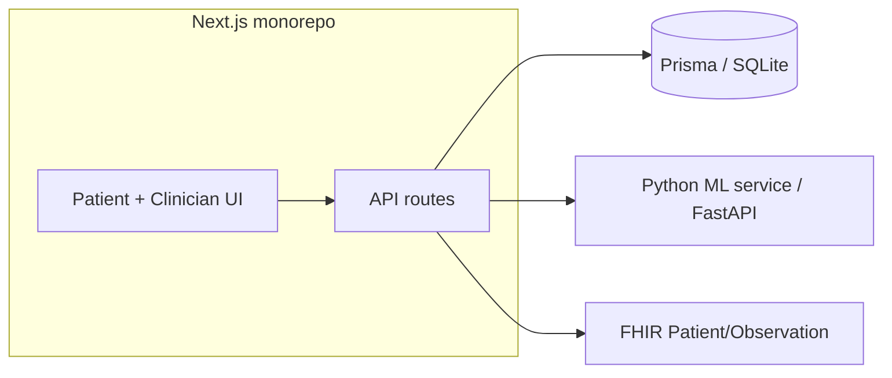

# ReproAI architecture

## Decisions

- **Monorepo with Next.js API routes** for a single deployable unit (Vercel-ready).
- **Python ML service kept separate** so the scikit-learn model can scale and be
  retrained independently.
- **No mocked/synthetic data.** The model trains on a real anonymized dataset; the
  application DB starts empty.
- **FHIR-aligned** observations and patients for interoperability (Sahhatna/Malafi concepts).
.
reproai/
├── README.md
├── package.json
├── next.config.js
├── tsconfig.json
├── tailwind.config.ts
├── postcss.config.js
├── .env.example                      # variáveis: DB_URL, ENCRYPTION_KEY, ML_API_URL, AUTH_SECRET
├── .gitignore
├── .eslintrc.json
│
├── prisma/                           # camada de persistência (SQLite -> Postgres)
│   ├── schema.prisma                 # modelos: User, Couple, Patient, Prediction, Observation, AuditLog, FollowUp
│   └── seed.ts                       # dados de demonstração para o pitch
│
├── public/
│   ├── logo.svg
│   └── locales/                      # i18n: pt, en, ar (Abu Dhabi)
│       ├── pt.json
│       ├── en.json
│       └── ar.json
│
├── src/
│   ├── app/                          # Next.js App Router (telas + API)
│   │   ├── layout.tsx                # layout raiz + providers (auth, i18n, theme)
│   │   ├── page.tsx                  # landing / escolha de perfil
│   │   ├── globals.css
│   │   │
│   │   ├── (auth)/                    # TELAS DE AUTENTICAÇÃO
│   │   │   ├── login/page.tsx
│   │   │   ├── register/page.tsx
│   │   │   └── consent/page.tsx       # consentimento informado + data governance
│   │   │
│   │   ├── patient/                   # APP DO PACIENTE (casal)
│   │   │   ├── layout.tsx
│   │   │   ├── onboarding/page.tsx    # recolha inicial + consentimento
│   │   │   ├── dashboard/page.tsx     # visão geral do casal
│   │   │   ├── assistant/page.tsx     # assistente conversacional (empático)
│   │   │   ├── fertility-window/page.tsx  # janela de fertilidade
│   │   │   ├── lifestyle/page.tsx     # sugestões OMS (sono, IMC, hábitos)
│   │   │   ├── data-entry/page.tsx    # entrada manual + mock Apple/Google Health
│   │   │   └── reports/page.tsx       # histórico de previsões
│   │   │
│   │   ├── clinician/                 # DASHBOARD DO MÉDICO
│   │   │   ├── layout.tsx
│   │   │   ├── dashboard/page.tsx     # lista de casais + nível de risco
│   │   │   ├── patient/[id]/page.tsx  # detalhe: prob. sucesso + fatores (SHAP)
│   │   │   ├── protocols/page.tsx     # protocolos clínicos sugeridos
│   │   │   ├── follow-up/page.tsx     # CLOSED-LOOP: alerta→consulta→acompanhado→encerrado
│   │   │   └── reports/[id]/page.tsx  # relatório PDF gerado pela IA
│   │   │
│   │   └── api/                       # BACKEND (Next.js API routes)
│   │       ├── auth/[...]/route.ts    # autenticação (paciente vs médico)
│   │       ├── predict/route.ts       # chama o serviço ML, devolve prob + fatores
│   │       ├── patients/route.ts      # CRUD pacientes/casais
│   │       ├── patients/[id]/route.ts
│   │       ├── observations/route.ts  # dados de wearables / entrada manual (FHIR)
│   │       ├── follow-up/route.ts     # estados do closed-loop
│   │       ├── reports/route.ts       # geração de PDF
│   │       ├── fhir/
│   │       │   ├── Patient/route.ts   # recurso FHIR Patient
│   │       │   └── Observation/route.ts
│   │       └── health/route.ts        # healthcheck
│   │
│   ├── components/                    # componentes reutilizáveis (UI)
│   │   ├── ui/                        # botões, cards, inputs (Tailwind)
│   │   ├── charts/
│   │   │   ├── SuccessProbabilityChart.tsx
│   │   │   └── FeatureImportanceChart.tsx
│   │   ├── assistant/
│   │   │   └── ChatWindow.tsx
│   │   ├── patient/
│   │   │   └── FertilityWindowCard.tsx
│   │   ├── clinician/
│   │   │   ├── PatientRiskTable.tsx
│   │   │   └── FollowUpTracker.tsx
│   │   └── layout/
│   │       ├── Navbar.tsx
│   │       └── Sidebar.tsx
│   │
│   ├── lib/                           # lógica partilhada / utilitários
│   │   ├── db.ts                      # cliente Prisma
│   │   ├── auth.ts                    # sessão + perfis (RBAC)
│   │   ├── encryption.ts              # encriptação de dados sensíveis (at rest)
│   │   ├── audit.ts                   # audit log de acessos clínicos
│   │   ├── fhir.ts                    # mapeamento modelos <-> FHIR
│   │   ├── ml-client.ts               # chamadas ao serviço ML (FastAPI)
│   │   ├── pdf.ts                     # geração de relatórios PDF
│   │   └── guidelines.ts             # regras de estilo de vida (OMS)
│   │
│   └── types/
│       └── index.ts                   # tipos TS partilhados (Patient, Prediction, etc.)
│
├── ml/                                # SERVIÇO DE MACHINE LEARNING (Python)
│   ├── requirements.txt               # scikit-learn, pandas, numpy, fastapi, uvicorn, shap, joblib
│   ├── generate_synthetic_data.py     # gera dataset sintético realista
│   ├── train.py                       # pipeline de treino (GradientBoosting/LogReg)
│   ├── evaluate.py                    # métricas: ROC/AUC, matriz confusão, calibração
│   ├── serve.py                       # FastAPI: endpoint /predict com SHAP + disclaimer
│   ├── schema.py                      # Pydantic: variáveis de entrada/saída
│   ├── data/
│   │   └── synthetic_fertility.csv    # gerado
│   ├── models/
│   │   └── model.joblib               # artefacto serializado
│   └── notebooks/
│       └── model_report.ipynb         # relatório de métricas
│
├── docs/                              # documentação para o pitch
│   ├── architecture.md                # diagrama mermaid + decisões
│   ├── evaluation-mapping.md          # mapeia os 6 critérios do júri
│   ├── data-governance.md             # privacidade, consentimento, FHIR, Sahhatna/Malafi
│   └── demo-checklist.md              # roteiro da demonstração
│
└── .gitlab-ci.yml                     # CI: lint, test, build, (deploy Vercel)
