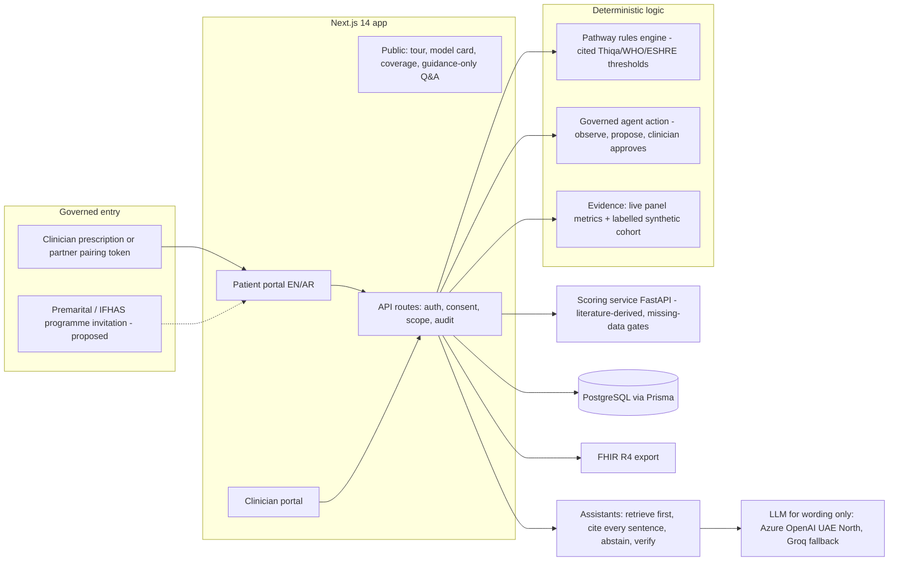

# ReproAI architecture

The diagram for the submission is `docs/reproai-architecture.html` (exported to `docs/images/reproai-architecture.png`). Full detail is in [technical-documentation.md](technical-documentation.md). This page replaces an earlier plan (SQLite, a scikit-learn model trained on a dataset) that was never used by the app.

## The gated pipeline

consent → data completeness → deterministic scoring → explanation → clinician review and note → release to patient → follow-up → audit.

A failed gate stops what follows: a missing required input returns `insufficient_data` with no estimate; withdrawn consent hides the record and blocks assessment; a draft never reaches the patient.

## Design decisions

- **Numbers come only from deterministic, versioned code.** The scoring service and the rules engine compute; the LLM only phrases answers from retrieved, cited passages and is never in the action path.
- **The agent action is deterministic.** It reads the record and the triggered rules, proposes one follow-up with its rationale and a draft note, and writes nothing until the clinician approves. Proposal, approval and dismissal are audit-logged.
- **Separate scoring service** so the model can be versioned, replaced or recalibrated without touching the app.
- **Provenance on every value** (clinician verified, imported, self-reported, recorded earlier).
- **Synthetic data only** in the prototype: demo personas and a fixed-seed simulated cohort.

## Deployment

| | Prototype | Production (proposed) |
| --- | --- | --- |
| App | Vercel | Azure App Service or Container Apps, UAE North |
| Database | Neon PostgreSQL (AWS us-east-2); AES-256-GCM on sensitive text fields | Azure Database for PostgreSQL, UAE North; managed keys; lab values encrypted too |
| Scoring service | FastAPI container | Same, UAE region |
| LLM | Azure OpenAI gpt-5-mini in UAE North; Groq (US) fallback | Azure OpenAI UAE North only; remove the Groq fallback |
| Integration | FHIR export | Malaffi lab import, TAMM entry point |

See [azure-integration.md](azure-integration.md) and [data-governance.md](data-governance.md).
