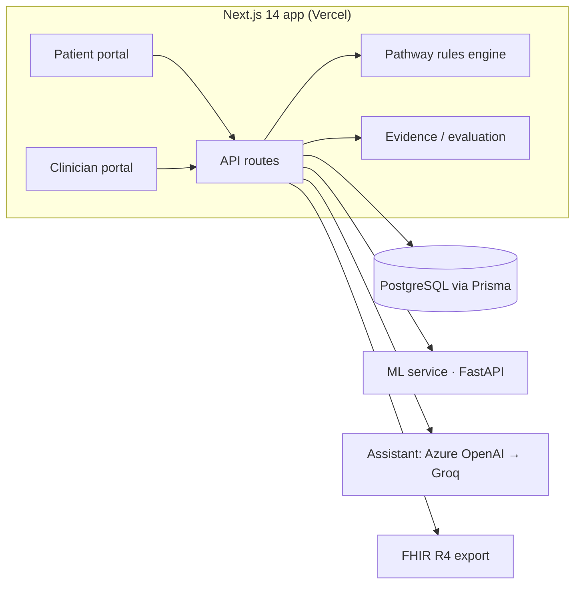

# ReproAI technical documentation, assumptions and limitations

Submission document for the Future Health Digital Innovation Challenge, Fertility · Challenge 02 "Reproductive Potential" (prototype due 20 November 2026). It describes what the prototype does, how, what it assumes and where it stops. Evidence status labels used throughout:

| Label | Meaning |
| --- | --- |
| **Runs in prototype** | Implemented and exercised end to end in this repository. |
| **Simulated** | Uses synthetic records with a fixed seed; checks behaviour, not clinical performance. |
| **Proposed for production** | Designed and documented, not built. |
| **Not clinically validated** | No claim of clinical accuracy, safety or regulatory approval. |

---

## 1. What ReproAI is

ReproAI gives individuals and couples an evidence-led, understandable view of how their reproductive potential changes over time, and turns it into timely, personalised options, with the clinician in control and the person in control of their data. It deliberately avoids a single "fertility score".

**Intended use:** decision support for licensed clinicians and plain-language education for patients. It does not diagnose, prescribe or replace clinical judgement. *(Runs in prototype; not clinically validated.)*

**Users**

- **Individuals and couples**, enrolled through a clinician prescription or a partner pairing link (programme invitations from screening services are *proposed for production*).
- **Clinicians**, who see only the people they prescribed, record verified results, run and review assessments, and follow up alerts.
- **The health system**, through the evidence dashboard's panel-level measures and anonymous statistics from people who opt in.

## 2. How it meets the brief

| Brief requirement | How | Status |
| --- | --- | --- |
| **R1 Longitudinal view** | Per-marker trajectories (AMH, AFC, semen parameters) against reference limits and the person's first result, with direction-of-change wording; basal temperature and sleep series; estimate history for clinicians. Only data the person has consented to is combined. | Runs in prototype |
| **R2 Plain language, evidence, missing data** | Missing required inputs stop the assessment (`insufficient_data`) and name what is missing; missing optional inputs widen the interval and show in a completeness meter. Modifiable vs fixed factors, per-factor Shapley contributions, cited options, evidence-status chips, provenance on every value. | Runs in prototype |
| **R3 Timely, personalised options** | Deterministic pathway rules with IDs and citations (WHO 2025, WHO semen manual, ESHRE, POSEIDON, the Daman Thiqa ART guideline): red flags, referral by time trying and age, ovarian-reserve testing, preservation discussion (including the Thiqa social egg-freezing pathway), semen re-testing, preconception counselling, weight, smoking and sleep. Every option states why and its source, and the intended-use boundary is shown. | Runs in prototype |
| **R4 Clinician and system usefulness** | Clinician case record (verified labs, intake, triggers, draft review, history, wearables, FHIR R4 export, printable case report), follow-up board, cohort dashboard, cases drill-down, and an evidence dashboard with panel measures by sex and age group. | Runs in prototype; system-level view across clinics proposed |
| **R5 Privacy, non-discrimination, control** | Per-purpose consent (care-team access, lab results, wearables, partner sharing, anonymous statistics) chosen at activation, changeable at any time, enforced in the API, audited; non-discrimination guarantee shown; clinicians scoped to their own panel; no open patient or clinician sign-up. | Runs in prototype |
| **R6 Evidence of earlier action** | Live panel measures (time from signal to appointment and closure from audit-logged transitions, signals acted on, referral follow-through, baseline coverage, review turnaround) with Wilson 95% intervals; a simulated cohort reporting false reassurance of the reduced-reserve rule under test variability and calibration against an independent reference curve; a list of what a pilot must still measure. | Runs in prototype (live) · Simulated (cohort) |

### P1 additions

| Addition | What it does | Status |
| --- | --- | --- |
| **Population insight** (`/clinician/insights`) | Groups who would benefit from earlier advice, built from the same rule IDs: red flags, due referral, reduced reserve, no reserve baseline, preservation window, male factor, lifestyle. Panel view names people (care-team consent only); service view is anonymous, opt-in only, and suppresses groups under 5. | Runs in prototype |
| **Clinical copilot** (`/clinician/assistant`) | Explains one case from a fact sheet built from the record (consented members only). The scoring tool is withheld from the LLM; only guideline search is available. Every number in a reply is checked against the record and flagged if not found. A failed LLM call returns a labelled scripted summary. | Runs in prototype |
| **Arabic (RTL)** | Language switch in the patient portal; right-to-left layout; Arabic navigation, trajectory, tiers, percentile wording, marker names, all pathway options and consent text. Clinician notes keep their original language. A notice states the translation awaits review by a native-speaking clinician. | Runs in prototype |
| **What-if simulator** | Re-scores the patient's latest released assessment with only BMI changed (the only modifiable model input) and reports whether BMI's contribution improves, not a new probability. Sleep and smoking are explained from evidence, not simulated. Nothing is saved. | Runs in prototype; illustrative |
| **Cases drill-down** (`/clinician/cases`) | The dashboard's metric tiles and estimate-band legend rows link here: a summary strip (all, assessed, and the three bands) switches the filter through the URL so a view can be shared, and couples and individuals appear as one list with a Type column (shared `CaseTable`). | Runs in prototype |
| **Governed agent action** (`/clinician/assistant`, `/api/clinician/actions`) | On a case, the copilot can propose the next action: a deterministic proposal citing the exact rule IDs it used, with a draft note — it writes nothing on its own. Approval is rebuilt and checked server-side (the client cannot supply text), opens a follow-up triage card, hands the draft note to the release flow, and writes audit events for proposal, approval and dismissal. No LLM in the action path. | Runs in prototype |
| **Guided demo** (`/tour`) | Nine scripted steps that follow a story arc — one person, root cause, reframe, the governed agent loop, refusal gates, outcome, scope, proof, then a hands-on handover in Arabic — each naming the brief requirement it answers, including a missing-data case and a no-consent case. A floating bar moves between steps and switches persona. Requires `DEMO_LOGIN_ENABLED`. | Runs in prototype |

### Grounded assistants (RAG)

Both assistants, the patient's **Ask ReproAI** and the clinician copilot, use one pipeline in `src/lib/rag/`. The aim is that every sentence a person reads can be traced to a source, and that the assistant says "not in the guidance" instead of guessing.

1. **A cited corpus** (`corpus.ts`): short paraphrased passages, each with document, section, page and URL, and a status that says how strongly it is backed. *Primary* passages come from the Daman Thiqa ART guideline v3.6 (page numbers from the PDF); *summary* passages from WHO's announcement of its 2025 infertility guideline (not the full text); *scope* passages only say a document exists (ESHRE 2020 preservation, WHO 2021 semen manual), with no clinical figures taken from them; *internal* passages describe how ReproAI works. Facts not verified against a source were left out. The earlier hand-written snippets in `src/lib/guidelines-local/` were never verified and are no longer retrieved.
2. **Retrieval always runs first** (`retrieve.ts`): BM25 with light stemming and a lay-to-clinical synonym map. Azure AI Search is used instead when `AZURE_SEARCH_*` is set. The LLM never decides whether to look something up. Arabic questions are handled at retrieval time, not by the LLM: `src/lib/rag/arabic.ts` detects Arabic query pieces and maps them through a fixed, auditable Arabic→English lexicon (one English corpus term per key) before matching; unmapped Arabic words stay unmatched, so coverage falls honestly. The corpus itself stays English-only, and per-language figures are reported separately in `eval-results.json`.
3. **Abstention**: if the best passage scores below a fixed threshold, or covers too few of the question's terms, no answer is generated and the person sees "Not in ReproAI's guidance".
4. **The record is a source too** (`record-passages.ts`): the patient's released record (latest labs with dates and provenance, released assessment tier and percentile, clinician note, triggered options) or the clinician's case facts become citable passages. Patients never get a probability or a draft.
5. **Constrained generation** (`answer.ts`): the LLM sees only the retrieved passages and must reply in JSON, one entry per sentence, each with the passage IDs it relies on, or declare the question unanswerable.
6. **Verification after generation**: each sentence must cite passages that were actually retrieved; every number must appear in a cited passage; most of its content words must appear there; quotations must match; and an optional second LLM pass (`RAG_JUDGE=on`, always on in the evaluation) checks support. Patients see only sentences that pass. Clinicians see failing sentences highlighted with the reason.
7. **Fallbacks and safety**: if the LLM is unavailable, the most relevant passages are shown as written (or, for a case, the labelled scripted summary). Questions describing urgent symptoms (heavy bleeding, severe pain, self-harm) get a fixed message to call 998 or go to an emergency department, without generation.
8. **Tools**: the patient assistant has no tools. `/api/agent` is now clinician-only and no longer offers the scoring tool; `search_guidelines` returns corpus passages with IDs and an `abstained` flag.
9. **Measurement**: `npm run rag:eval` runs the questions in `eval-set.ts` (answerable, out-of-domain, in-domain but not covered, and rule-breaking) and writes `eval-results.json`, which the Evidence page shows with Wilson intervals and a list of every miss.

## 3. Architecture



- **Web app:** Next.js 14 App Router, TypeScript (strict), Tailwind 3; API routes in `src/app/api`.
- **Data:** PostgreSQL (Neon) through Prisma. Models: `User`, `Couple` (care case), `Patient` (profile and self-reported intake), `LabResult` (value, unit, date, **source**, entered by), `Prediction` (result, **status** DRAFT/RELEASED/DISCARDED, completeness, inputs with provenance, reviewer and note), `Observation` (wearables), `Consent` (per purpose), `FollowUp`, `Invitation`, `PairingInvite`, `AuditLog`.
- **ML service:** `ml-service/main.py`, FastAPI; deterministic scoring, no LLM.
- **Assistants:** grounded retrieval-and-verification pipeline in `src/lib/rag/` behind `/api/patient/ask` and `/api/clinician/copilot`; see "Grounded assistants (RAG)". `/api/agent` is a clinician-only tool-calling agent limited to guideline search.

## 4. The gated assessment pipeline

Assessments are only created by a clinician from the record, never typed in by the patient.

1. **Consent:** each member must have granted care-team access (and partner sharing for joint assessments). Otherwise the request is refused.
2. **Verified data:** inputs are read from the record. Labs come from `LabResult` with their source and date; age, BMI and history are self-reported. Nothing is entered at assessment time.
3. **Calculate (ML service):** required inputs per type are checked first.
   - Individual female: age, AMH. Optional: BMI, AFC, PCOS history, months trying.
   - Individual male: age, sperm concentration. Optional: BMI.
   - Couple: female age, AMH, sperm concentration. Optional: BMI, PCOS history, months trying, previous cycles.
   - Missing required → `insufficient_data`, no estimate, nothing saved. Missing optional → its contribution is set to the reference baseline (Shapley value 0) and the interval widens by 0.04 log-odds SE per missing input.
4. **Explain:** exact additive Shapley values per factor; plain-language tier and summary; the assistant can explain in conversation.
5. **Clinician review:** the result is saved as a **DRAFT** with its inputs, provenance, completeness and evidence status. The clinician reads it and either releases it with a note to the patient (minimum length enforced) or discards it.
6. **Release:** only released assessments are visible to the patient; until then the patient sees that a result is with their clinician.
7. **Follow-up and audit:** every step (lab entry, run, release, discard, consent change, case view) is written to the audit log; wearable anomalies and low joint estimates raise follow-up alerts.

## 5. The scoring model

`ml-service/main.py`, version `literature-spline-shapley-2.1`.

- Additive log-odds model with smooth curves for age, AMH, sperm concentration, BMI, PCOS history, months trying and previous cycles, derived from published sources (HFEA 2022, CDC ART 2022, WHO semen manual 2021, ESHRE 2020–2023, POSEIDON, Bhattacharya et al. 2021).
- Exact Shapley decomposition (for an additive model, φᵢ = fᵢ(xᵢ) − E[fᵢ(X)]).
- 95% interval by the delta method on the log-odds scale, widened for missing optional inputs, age ≥ 40 and ≥ 3 previous cycles.
- For individual women, an AMH-for-age percentile against an exponential age-median curve.
- **Not fitted to or validated on patient data. No discrimination or calibration statistic is claimed.** Earlier versions of this repository reported "ROC-AUC 0.792, calibrated via isotonic scaling"; that claim was unsupported and has been removed.

**How the estimate is shown:** individuals see their markers, a plain-language tier and percentile, not a probability. The probability appears for couples who are trying, after clinician review, always with its interval and limitations.

## 6. Pathway rules

`src/lib/pathways.ts`. Deterministic; each rule has an ID, trigger, patient wording, clinician wording, reason and source. Key thresholds come from the Daman Thiqa ART adjudication guideline v3.6 (Nov 2025), the local payer rule set:

| Rule | Trigger | Option |
| --- | --- | --- |
| RF-CYCLE | Irregular or absent periods | See a doctor without waiting 12 months |
| RF-HISTORY | Chemotherapy, pelvic infection or surgery, endometriosis, genetic condition, undescended testis | Earlier specialist advice |
| REF-12M / REF-6M-35 / REF-40 | Trying ≥ 12 months; > 35 and ≥ 6 months; ≥ 40 and trying | Specialist referral |
| RES-LOW | AMH < 1.1 ng/mL or AFC < 5 | Specialist discussion |
| TEST-AMH | Woman ≥ 30 (or family history of early menopause) with no AMH | Discuss ovarian-reserve testing |
| PRES-DISCUSS | Not trying, 25–38, and interest, low reserve, lower-quartile percentile or chemotherapy | Preservation discussion; Thiqa social egg freezing: 2 cycles lifetime, 5-year storage, psychological assessment |
| SEM-LOW | Any semen parameter below reference (concentration 15 M/mL, total motility 40%, progressive 32%, morphology 4%, volume 1.5 mL) | Repeat analysis; andrology/urology |
| TEST-SEMEN | Man trying, paired or with risk history, no semen analysis | Offer analysis |
| BBT-MONO | No sustained temperature rise | Ask about ovulation confirmation |
| BMI-35-40 / BMI-OUT | BMI 35–40; < 19 or > 40 | Dietitian before treatment; eligibility note |
| OPT-* | Smoking, BMI 25–35, sleep < 7 h | Health optimisation |

## 7. Security, privacy and governance

- **Authentication:** bcrypt passwords; HTTP-only signed JWT session cookies; role-gated routes in middleware.
- **No open sign-up:** patients activate only with a prescription or pairing token tied to the invited email; clinician self-registration is disabled (an `ALLOW_CLINICIAN_SIGNUP` flag exists only to bootstrap a fresh deployment).
- **Clinician scope:** a clinician can open only cases they prescribed, or whose members they invited (directory, case record, labs, assessments, follow-ups, FHIR, reports, observations).
- **Consent:** five purposes with documented defaults (care-team access, lab results, wearables, partner sharing on; anonymous statistics off), chosen at activation, changeable at any time, enforced in the API and audited. Revoking care-team access hides the record from the clinician immediately and blocks assessments; revoking wearables blocks uploads; revoking partner sharing hides details from the partner and blocks joint assessments.
- **Non-discrimination:** shown to every patient: reproductive information is never used for employment, insurance or decisions unrelated to care.
- **Provenance:** every lab result and assessment input carries its source (clinician verified, self-reported, imported) and date.
- **Audit:** logins, registrations, consent changes, lab entries, assessment runs, releases, discards, case views and follow-up transitions.
- **Interoperability:** FHIR R4 export of `Patient`, `Observation` and `RiskAssessment` resources for a case or a person.

## 8. Assumptions

1. Laboratory values entered by clinicians are correct and from accredited laboratories; ultrasound AFC is from a fertility specialist (as the Thiqa guideline requires).
2. Self-reported intake (age, height, weight, history, cycle pattern, smoking) is honest but unverified, and is labelled as such.
3. Biological sex is recorded at activation for choosing the relevant markers; the product makes no assumption about family choices.
4. The reference limits in the rules are those of the Thiqa guideline and WHO; they are population thresholds, not individual diagnoses.
5. The literature-derived curves are a reasonable starting point for decision support while real outcome data are unavailable; they are expected to be recalibrated on local data before any clinical use.
6. Partners are paired only by mutual, explicit action, and either can unpair at any time without data loss.
7. The simulation's reference curve (age-band live-birth rates shaped like national registry summaries, with a reduction for very low reserve) is a plausible but simplified stand-in for real outcomes.

## 9. Limitations

- **No clinical validation.** No study has measured accuracy, calibration, benefit or harm in real patients. The simulated cohort shows the model overestimating against the reference curve (calibration-in-the-large of about −16 percentage points in the current run), which is why individuals are not shown a probability.
- **False reassurance is real.** With 20% test-to-test AMH variation, the reduced-reserve rule misses about 1 in 9 truly low reserves in the simulation. The product mitigates this with reference limits, dates, provenance, repeat-testing suggestions and clinician review; it cannot remove it.
- **What the model does not see:** tubal patency, uterine factors, endometriosis severity, oocyte quality, DNA fragmentation, genetics, partner-specific interactions beyond the inputs listed.
- **Single-measurement inputs:** the model uses the latest result; it does not yet model measurement error or trends directly.
- **Small live samples:** panel measures in a prototype rest on very few people; intervals are wide and subgroup results are not interpretable.
- **Equity:** nationality and language are not yet recorded, so equitable reach cannot be reported by those groups.
- **Arabic:** a prototype translation covering navigation, trajectory, options and consent; it needs review by a native-speaking clinician, and the intake, Today and tracking pages are still English-only.
- **Wearables:** readings are logged or pasted; there is no certified device integration. Basal temperature is a weak, retrospective ovulation signal.
- **Assistants:** depend on an external LLM provider and may be unavailable (they then show source passages as written). The corpus is small (about 40 passages) and English-only, so Arabic questions are usually refused (the evaluation measures this with 10 Arabic questions, reported separately on the Evidence page); the WHO 2025 passages come from WHO's announcement rather than the full guideline. Verification is automatic: the number, wording and quotation checks catch fabricated figures and off-source wording, but a sentence can reuse the source's words and still mislead, and the LLM judge can be wrong. The evaluation questions were written by the team and the thresholds were tuned on them, so its figures are optimistic.
- **Data protection:** encryption at rest for sensitive fields is not yet applied (the helper exists); production would also need ADHICS-aligned hosting in the UAE.
- **Notifications:** invitation and pairing links are shown to copy; no email or SMS is sent.

## 10. Path to pilot (proposed for production)

1. **Integrations:** verified labs from Malaffi (FHIR); entry from TAMM (formerly Sahatna) and from premarital and IFHAS screening invitations; Health Age linkage.
2. **Governance:** DoH Responsible AI Standard (Oct 2025) conformity review (self-assessment and gaps: [doh-responsible-ai-mapping.md](doh-responsible-ai-mapping.md)), ADHICS security, UAE data residency, encryption at rest, clinical safety case.
3. **Pilot:** one primary-care cluster and one fertility centre for 6 months. Primary outcome: time from first risk signal to counselling. Secondary: referral completion, preservation discussions within the effective age window, informed-choice quality, anxiety, false reassurance, clinician workload, equity by nationality, age and sex.
4. **Model:** recalibrate and externally validate on Abu Dhabi outcomes before showing any probability outside clinician review.

## 11. Running and testing

See the README for setup. To exercise the full flow:

```sh
npm run demo:setup            # demo personas: female, male, couple (needs the ML service)
DEMO_LOGIN_ENABLED=true npm run dev
```

Then open `/tour` for the nine-step guided demo, or use the demo buttons on the login page. Personas: a clinician; a female individual; a male individual; a paired couple with a draft joint assessment awaiting review and an open alert; a patient with no lab results (missing-data gate); and a patient who has withdrawn care-team access (consent enforcement).
